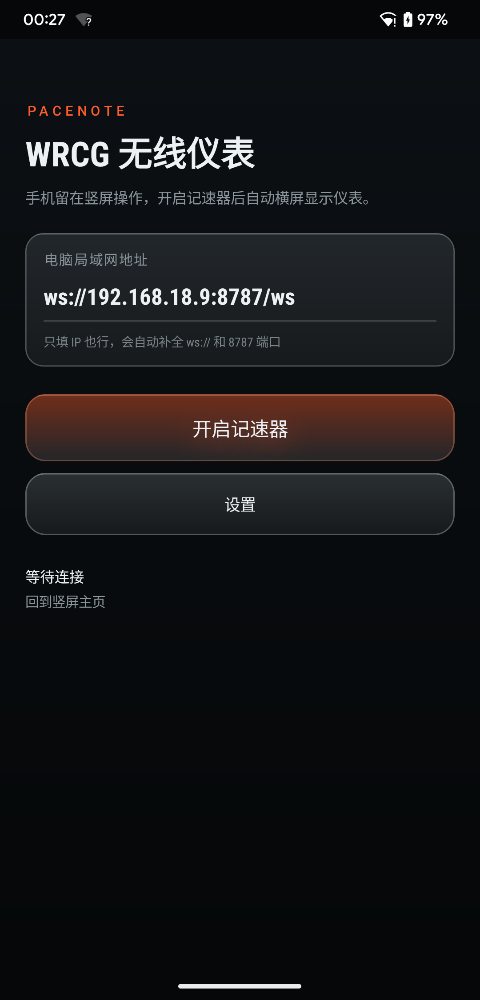
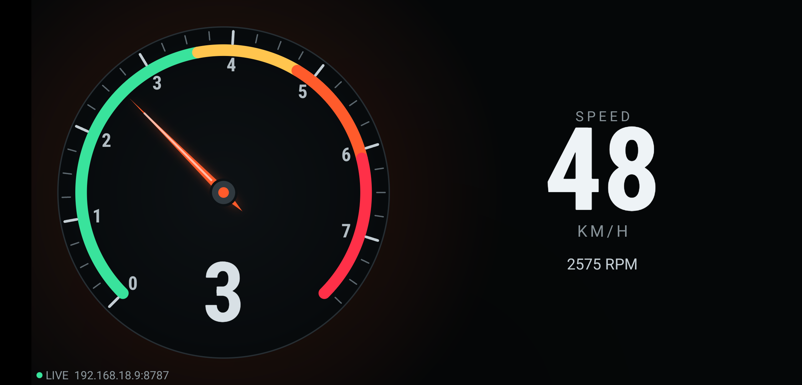
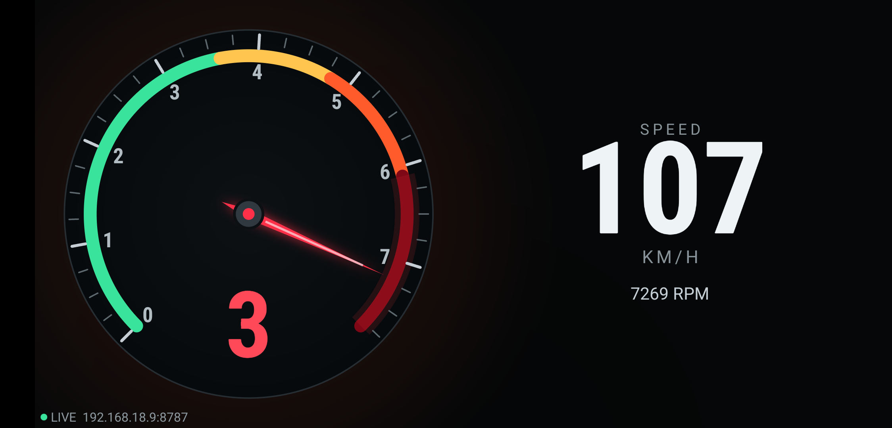

# WRCG 无线仪表盘 · Android 版

把 WRCG 赛车游戏的遥测数据，从电脑经局域网实时投到手机上做仪表盘。

电脑接收游戏 UDP 遥测 → 本地 Node 服务转成 WebSocket → 手机 Wi-Fi 连接 → 全屏横屏仪表。

```text
WRCG UDP :20777  ->  电脑 :8787 (WebSocket)  ->  Wi-Fi  ->  Android App
```

> 本仓库是 [jhon326](https://github.com/jhon326) 的修改版（fork），在原有工程基础上重做了 Android 端界面，
> 并提供了可直接安装的正式签名安装包。

## 截图

| 竖屏主页 | 横屏记速器 | 红转爆闪 |
|---|---|---|
|  |  |  |

## 直接安装

下载 [`release/WRCG-Dash-4.0.0-release.apk`](release/WRCG-Dash-4.0.0-release.apk) 安装到手机：

- 适用于 Android 8.0（API 26）及以上
- 已用正式签名（见下方「签名信息」），可覆盖升级
- 安装时如提示「未知来源」，允许当前文件管理器或浏览器安装即可

也可以用 ADB：

```powershell
adb install -r release/WRCG-Dash-4.0.0-release.apk
```

## 这个版本改了什么

相比上游工程，Android 端做了四项重做：

1. **竖屏主页 + 横屏记速器**
   启动为竖屏，填好地址点「开启记速器」才切横屏；返回键回到竖屏主页，不再全程锁死横屏。

2. **自定义局域网地址输入**
   主页直接填写电脑 IP（`192.168.1.100`）、`IP:端口` 或完整 `ws://` 地址，
   自动补全协议、端口与 `/ws` 路径，保存在本地，下次启动自动回填。

3. **指针式汽车速度表**
   替换原来的六根竖柱，改为 270° 圆形表盘：长短刻度、四段色带（绿/黄/橙/红）、
   锥形指针带 0.22 插值平滑动画；表盘内大挡位字，右侧 SPEED / KM/H / RPM 数字读数；
   红转时指针与挡位变红、色带爆闪。

4. **毛玻璃控件**
   所有按钮、卡片、设置项统一为半透明渐变 + 高光描边的毛玻璃质感，
   按下时着色加深并做 `0.96 → 1.0` 回弹缩放，点击反馈明确。

同时修复了两个交互问题：targetSdk 33+ 下预测性返回导致 `onBackPressed()` 失效、
设置面板被主页遮挡的层级问题。

## 使用方法

1. 在电脑上启动本仓库的桌面服务（或上游的 `WRCG-Dash-Desktop.exe`），确保监听 `8787`
2. 手机与电脑连接同一 Wi-Fi / 热点
3. 打开 App，在主页填写电脑地址，例如 `192.168.1.100`
4. 点「开启记速器」，自动横屏进入仪表
5. 记速器界面双指上滑可打开设置（主题、转数阈值、爆闪、连接、延迟检查）

没有游戏数据时，电脑端会输出模拟遥测，可用于检查界面与链路。

## 从源码构建

环境要求：

- JDK 17 或以上
- Android SDK Platform 36 + Build-Tools 36.0.0
- Gradle 由 wrapper 提供（9.9.1），无需单独安装

```powershell
cd android-app
.\gradlew.bat assembleRelease
```

或直接双击 `android-app\build-apk.cmd`，产物会复制到 `..\dist\WRCG-Dash-4.0.0-release.apk`。

### 签名配置

正式签名参数从项目根目录的 `signing.properties` 读取（该文件与签名库均不入库）：

```properties
storeFile=signing/wrcg-release.jks
storePassword=你的库口令
keyAlias=wrcg
keyPassword=你的密钥口令
```

没有该文件时，`assembleRelease` 只会产出未签名包；自行构建请换成你自己的签名库。

## 签名信息

| 项 | 值 |
|---|---|
| 证书主体 | `CN=PACENOTE WRCG, OU=Mobile, O=PACENOTE, L=Beijing, ST=Beijing, C=CN` |
| 算法 | RSA 2048 / SHA256withRSA |
| SHA-256 | `E6:97:C2:DF:D1:DB:7F:B7:1A:2E:F9:BB:0A:77:60:53:EF:87:1A:9F:C3:75:9E:C9:F1:04:FA:65:D6:76:26:8B` |

> 私钥不在仓库中。后续版本必须使用同一签名库，否则无法覆盖升级。

## 目录结构

```text
.
├─ android-app/            原生 Android 工程（Java + Canvas，无第三方依赖）
│  ├─ app/src/main/java/com/pacenote/wrcgdash/
│  │  ├─ MainActivity.java     竖屏主页、设置面板、方向切换
│  │  ├─ DashboardView.java    指针式仪表绘制
│  │  ├─ TelemetryClient.java  自实现 WebSocket 客户端
│  │  └─ GlassDrawable.java    毛玻璃背景
│  ├─ build-apk.cmd        一键打包 release
│  └─ install-apk.cmd      一键安装到设备
├─ release/                已签名安装包
├─ docs/screenshots/       界面截图
├─ src/                    电脑端 Node 服务（HTTP / UDP / WebSocket）
├─ public/                 浏览器版仪表页面
└─ tools/                  桌面 EXE 构建与 WRCG 配置脚本
```

## 相关文档

- [隐私说明](PRIVACY.md)
- [安全策略](SECURITY.md)

## 说明

本项目只处理局域网内的本地遥测数据，不上传账号、设备地址或驾驶数据。

Android 端为原生 Java 实现，不依赖 AndroidX / Material / 第三方网络库，包体约 650 KB。
